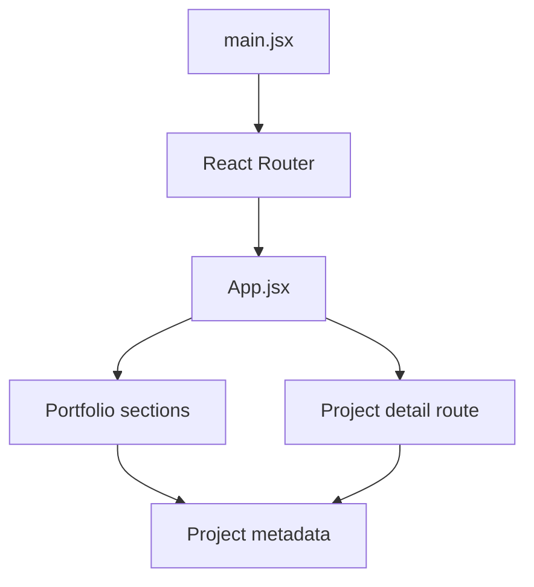

# Developer Portfolio — React + Vite

A responsive personal portfolio showcasing software engineering, AI/ML projects, technical skills, and project demonstrations.

## Overview

The frontend is built with **React**, **Vite**, **React Router**, **Tailwind CSS**, and animation libraries. Project content is maintained in JavaScript data files and rendered through reusable UI components.

## What is implemented

- Landing page with animated hero elements
- About, timeline, projects, skills, achievements, and contact sections
- Project cards and dedicated project-detail routes
- Animated transitions and interactive visual effects
- Data-driven project listings from `src/data/projects.js`

> This repository is a **frontend application**, not a backend or multi-agent system. Project descriptions are portfolio content and should be checked against each project's actual repository.

## Tech stack

| Area | Tools |
| --- | --- |
| UI | React 19, JavaScript |
| Build | Vite |
| Routing | React Router |
| Styling | Tailwind CSS |
| Animations | Framer Motion, Lottie, particle effects |

## Local development

Requirements: a recent Node.js LTS release and npm.

```bash
git clone https://github.com/kushalsrirangam/portfolio.git
cd portfolio
npm install
npm run dev
```

The terminal prints the local Vite URL (typically `http://localhost:5173`).

```bash
npm run lint   # ESLint
npm run build  # Production build
npm run preview
```

## Source map

```text
src/
├── App.jsx              # Route definitions and page composition
├── main.jsx             # React + BrowserRouter entry point
├── components/          # Shared sections and visual components
│   └── pages/           # Detail page components
├── data/
│   └── projects.js      # Portfolio project descriptions
└── index.css            # Global styling
```

The current structure is already appropriate for a frontend-only site. It does **not** need arbitrary `backend/`, `llm/`, or `agents/` folders.

## Component architecture



## Maintaining project entries

Update `src/data/projects.js` when adding a project. Verify the description, feature list, technologies, screenshots, and video links against the actual project; avoid claiming unfinished capabilities as deployed or production-tested.

For architecture and suggested cleanup work, see [docs/architecture.md](docs/architecture.md).

## Engineering roadmap

- Add automated component and route tests.
- Audit accessibility, mobile layouts, performance, and image sizes.
- Centralize repeated animation and UI patterns only where it reduces complexity.
- Include verified project source links and live demonstrations.
- Add GitHub CI for lint and production builds after confirming a clean baseline.

## Author

Kushal Sri Rangam — [GitHub profile](https://github.com/kushalsrirangam)
