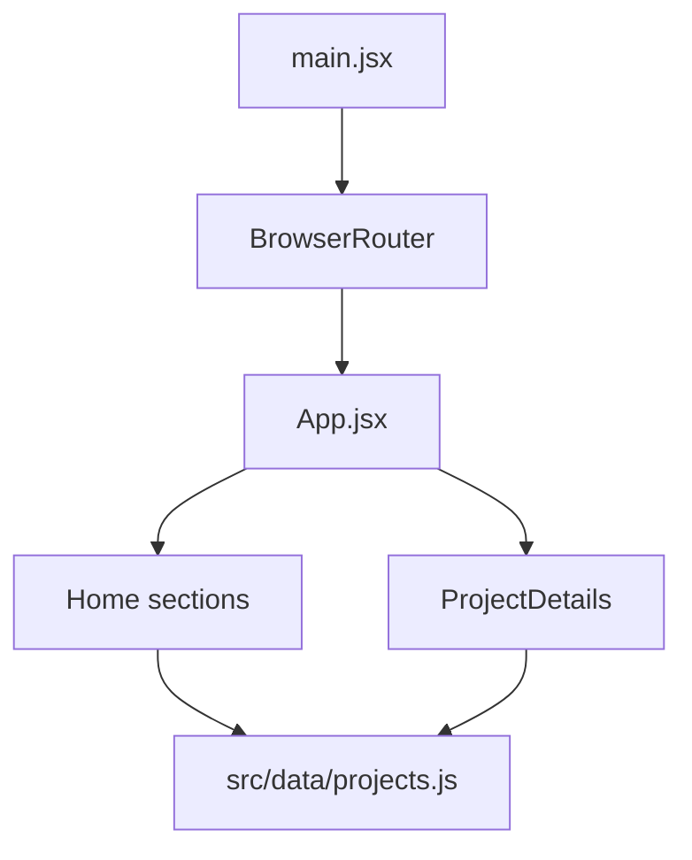

# Portfolio architecture and maintenance

## Current architecture
This is a React/Vite client application. `src/main.jsx` mounts React with `BrowserRouter`. `src/App.jsx` selects home and detail routes and composes UI sections from `src/components/`. `src/data/projects.js` stores structured project information.

## Safe organization
Keep the existing `src/components/` directory and routes in place to preserve imports. Proposed gradual grouping:
- `components/layout/` for navigation and footer
- `components/sections/` for home sections
- `components/projects/` for project cards and details
- `components/effects/` for shared animation elements
- `data/` for verified project records

Introduce groups only when moving files with updated imports and a successful production build.

## Quality roadmap
- Test home and project routes with React Testing Library.
- Add basic accessibility tests and image alt text audits.
- Verify and link GitHub repositories for project claims.
- Optimize heavy visual effects for low-power/mobile devices.
- Use GitHub Actions for lint and build when validated locally.

The portfolio itself does not need a Python backend, LLM, or AI agents.
